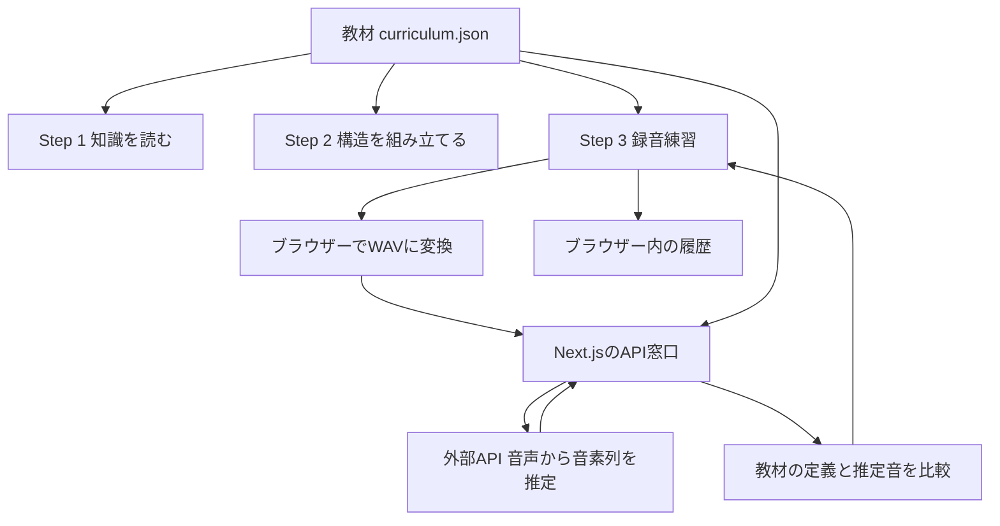
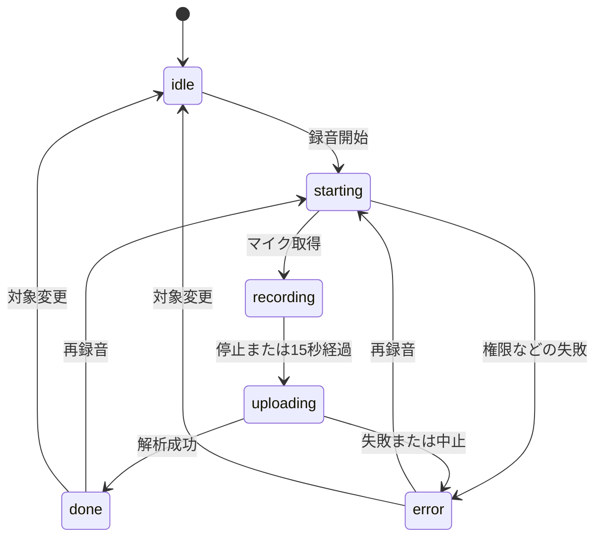
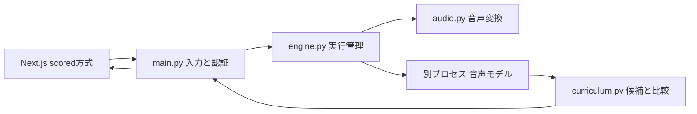

# ELPS-J コードの全体解説

この資料は、プログラミングを初めて学ぶ人が、このリポジトリーを自分で読めるようになるための解説です。2026年10月13日のコードを対象にしています。画面のコード、教材、解析との接続、Python、テスト、設定まで扱います。秘密の設定値は掲載しません。依存ライブラリーや自動生成ファイルの内部は対象外です。

まず1〜4章で仕組みをつかみ、その後、知りたい画面の章を読んでください。英語の名前は「何を担当しているか」と結びつけると覚えやすくなります。

## 1. このシステムは何をしている？

英語の発音について、次の3段階で学ぶシステムです。

| 段階 | URL | 学習者がすること | 中心になるコード |
|---|---|---|---|
| 入口 | `/` | 学習の流れを確認する | `app/page.tsx` |
| Step 1 | `/learn`、`/learn/ae` など | 発音記号、口・舌の使い方、例語を読む | `app/learn/` |
| Step 2 | `/components` | 部品と矢印で発音の構造を組み立てる | `app/components/` |
| Step 3 | `/practice` | 録音し、推定された音に基づくフィードバックを読む | `app/practice/` |

全段階で同じ `curriculum.json` を使います。「知識画面ではこの答え、組み立て問題では別の答え」という食い違いを減らす設計です。

現在の発音解析は外部APIに依頼しています。このリポジトリーにあるPythonの解析プログラムは、別の接続方式で使えるコードです。現在の外部APIそのもののソースは、このリポジトリーにはありません。



**押さえておきたい点：** 舌の高さや位置をカメラで測っているわけではありません。音声から音を推定し、その音に教材上どの構成要素が定義されているかを調べ、目標音の定義と比較しています。

## 2. ファイルとフォルダーを読むための基礎

### 拡張子の意味

| 拡張子 | 内容 | このシステムの例 |
|---|---|---|
| `.ts` | TypeScript。処理とデータの型を書く | `feedback.ts` |
| `.tsx` | TypeScriptに画面の記述を加えたもの | `Recorder.tsx` |
| `.json` | 決まった形で保存するデータ | `curriculum.json` |
| `.css` | 色、大きさ、配置などの見た目 | `globals.css` |
| `.py` | Pythonのプログラム | `backend/main.py` |
| `.mjs` | JavaScriptのモジュール | テストや設定 |
| `.md` | 説明文を書くMarkdown | `README.md` |
| `.yml` | 階層のある設定 | `docker-compose.yml` |

TypeScriptはJavaScriptに「この値は文字列」「この値は数値」といった型の説明を付けた言語です。ブラウザーに渡すときには、Next.jsが必要な変換を行います。

### フォルダーの地図

```text
elps-j/
├── app/                         画面・教材・Next.js側のAPI
│   ├── layout.tsx               全画面に共通する枠
│   ├── page.tsx                 トップページ
│   ├── globals.css              全体の見た目
│   ├── ThemeToggle.tsx          明るい/暗い表示の切り替え
│   ├── learn/                   Step 1
│   │   ├── page.tsx             発音記号の一覧
│   │   └── [slug]/page.tsx      記号ごとの解説
│   ├── components/              Step 2
│   ├── practice/                Step 3
│   ├── data/                    全画面で共有する教材
│   └── api/analyze-pronunciation/ 解析APIとの接続
├── backend/                     同梱されているPython解析サーバー
│   └── tests/                   Python側のテスト
├── tests/                       JavaScript側・画面のテスト
│   └── fixtures/                テスト用の解析結果
├── scripts/                     確認・運用用の補助プログラム
├── public/                      画像などの静的ファイル
├── docs/                        この解説資料
└── 各種設定ファイル
```

`components` という名前は「再利用する画面部品」にも使われますが、このプロジェクトでは **Step 2のURLを作るフォルダー名** でもあります。名前だけで用途を決めず、どこから読み込まれているかを見ると判断できます。

### Next.jsが名前に意味を持たせているファイル

- `page.tsx`：そのフォルダーのURLで表示する画面。
- `layout.tsx`：配下の画面を包む共通の枠。
- `route.ts`：画面ではなくHTTPリクエストを受け取る窓口。
- `[slug]`：URLの一部が変わるフォルダー。`/learn/ae` の `ae` などを受け取る。

`Recorder.tsx` のような自分で付けた部品名は、読み込み側も直せば変更できます。`page.tsx` のような特別な名前にはNext.jsのルールがあります。フォルダー名を変えるとURLも変わります。

### ブラウザーとサーバー

ブラウザーは、ユーザーのパソコンやスマートフォンで画面を表示するソフトです。サーバーは、通信を受けて処理する側です。

| 場所 | 担当 |
|---|---|
| ブラウザー | ボタン操作、マイク、音声変換、画面の状態、履歴保存 |
| Next.jsサーバー | ページの生成、外部APIへの中継、応答の検査、教材との比較 |
| 外部APIサーバー | 音声から音素列を推定する |

`'use client'` が付くファイルは、ブラウザーでの操作やReactの状態管理を使う部品です。ただし、最初の表示用のHTMLがサーバー側で作られることもあります。「必ず最初から最後までブラウザーだけで動く」という意味ではありません。

`app/` は画面だけのフォルダーではありません。`app/api/` のコードはサーバー側です。開発用の起動ではNext.jsを起動します。現在の外部APIを使う場合、同梱Pythonを同時に起動する必要はありません。

## 3. 実際のコードを読むための文法

### 変数、オブジェクト、配列

```ts
const word = 'cap';
const sound = { slug: 'ae', symbol: 'æ' };
const words = ['cap', 'cat'];
```

`const` は、その変数に別の値を再代入しないという宣言です。オブジェクトの中身まで自動的に変更禁止になるわけではありません。

`{}` は、名前付きの情報をひとまとめにするオブジェクトです。`sound.symbol` で `æ` を取り出します。`[]` は順番のある配列です。`words[0]` は最初の項目で、番号は0から始まります。

### 関数

```ts
function selectSound(next: SoundLesson) {
  setSound(next);
  setWord(next.examples[0]);
  recording.reset();
}
```

これは `Recorder.tsx` にある処理です。

1. `selectSound` は処理の名前。
2. `next` は渡される新しい音のデータ。
3. `: SoundLesson` は「教材の音1件という形のデータ」という型。
4. `setSound(next)` で選択音を更新。
5. その音の最初の例語を選ぶ。
6. 以前の解析表示をリセットする。

`return` は、関数から結果を返す、またはその場で処理を終えるための命令です。画面部品の `return` は「この画面を表示して」という記述を返します。

`(item) => item.group === sound.group` の `=>` も関数です。短い処理を名前なしで書くときによく使います。

### import / export

```ts
import AnalysisView from './AnalysisView';
export default function Recorder(...) { ... }
```

`import` は別ファイルから読み込むこと、`export` は別ファイルから使えるようにすることです。`./` は同じフォルダー、`../` は1つ上のフォルダーです。

`export default` はそのファイルの代表的な読み込み対象です。`export function feedbackGroups` のような名前付きの公開は、`import { feedbackGroups } ...` と名前を指定して使います。

### JSX：画面を書く記法

```tsx
<button onClick={recording.start}>録音を開始</button>
```

`button` はボタン、間の文字は表示文、`onClick` はクリックされたときの処理です。`recording.start` はここでは実行せず、実行する関数を渡しています。

```tsx
<p>{word.word}</p>
```

`{}` の中はJavaScriptの値として評価します。外側は画面の記述です。

| よく出る記述 | 意味 |
|---|---|
| `className="..."` | 見た目の指定。Tailwindのクラスが多い |
| `disabled={isBusy}` | 忙しい間は操作できなくする |
| `onClick={() => selectSound(item)}` | クリック時に、その項目を渡して処理する |
| `condition ? A : B` | 条件が成立したらA、そうでなければB |
| `condition && <p>...</p>` | 条件が成立したときに表示する |
| `key={item.slug}` | Reactが一覧の各項目を区別する印 |
| `aria-label` | 読み上げなどに使う名前 |
| `aria-pressed` | 切り替えボタンが選択中かを伝える |
| `role="status"` | 状況の変化を伝える領域 |

`className` が長くても、多くは「背景・余白・文字・枠・画面幅に応じた配置」です。処理を理解する最初の段階では `onClick`、`disabled`、`{}` の中を優先してください。

### 配列を扱う処理

| 記法 | 役割 | このシステムでの用途 |
|---|---|---|
| `map` | 各項目を別の値に変換する | 教材の一覧からボタンを作る |
| `filter` | 条件に合う項目だけ残す | 選択した分類の音を表示する |
| `find` | 条件に合う最初の項目を探す | slugから教材を探す |
| `findIndex` | 見つかった場所の番号を返す | 最初に表示する問題を選ぶ |
| `every` | 全項目が条件を満たすか | 必要な部品がそろったか |
| `includes` | 指定した値が含まれるか | その音を完了済みか |
| `slice(0, 200)` | 指定範囲だけ取り出す | 履歴の件数を制限する |
| `Object.entries` | オブジェクトを名前と値の組にする | 教材の構成要素を順に扱う |
| `Object.fromEntries` | 名前と値の組をオブジェクトにする | 必要な要素だけの構造を作る |
| `new Set(...)` | 同じ値の重複を除く集合 | 接続や発音記号の重複を扱う |

`[...current, sound.slug]` は既存配列を展開し、末尾に新しい値を足した新しい配列です。Reactでは、既存の状態を直接書き換えるより、新しい値を渡す形が基本です。

### null、false、undefined

- `null`：値がないことを意図して表す。比較不能な構成要素など。
- `false`：条件が成立しない。構成要素が一致しないなど。
- `undefined`：まだ指定されていない、項目が存在しないなど。

`matches === false` と `matches === null` は別の意味です。この区別が「変える要素」と「比較できない要素」を分けています。

`a?.b` は `a` がない場合にエラーを出さず、未指定の値を返す書き方です。`a ?? b` は `a` が `null` または `undefined` なら `b` を使います。`a || b` は空文字や0なども含め、偽と扱われる値なら `b` を使います。

### Reactの状態とHook

```ts
const [sound, setSound] = useState(initialSound);
```

`sound` が今の値、`setSound` が更新する関数、`initialSound` が初期値です。更新するとReactが画面を再計算します。再計算はページ全体の再読み込みとは違います。

| Hook | 役割 |
|---|---|
| `useState` | 画面に反映したい値を覚える |
| `useRef` | 録音機などを再描画の間も保持する。`.current`の更新だけでは再描画しない |
| `useEffect` | 保存データの読み込み、外部資源の片付けなどを行う |
| `useCallback` | 依存する値が変わらない間、関数を再利用する |
| `useMemo` | 依存する値が変わらない間、計算結果を再利用する |

`useEffect` が返す関数は後片付けです。マイク停止、タイマー解除、音声URLの解放などを行います。依存配列の `[]` は固定の依存関係を表します。開発時にはReactが問題を見つけるため、開始と後片付けを追加で確認する場合があります。

`useRecording` と `usePracticeHistory` は自分たちで作ったHookです。React標準のHookを組み合わせ、長い処理を画面から取り出しています。

### 非同期処理とエラー

`async` / `await` は、マイク取得や通信など、すぐには終わらない処理を順序立てて書くための記法です。`await fetch(...)` は通信の完了を待ちます。待つ間にブラウザー全体を止めるという意味ではありません。

`try` が通常の処理、`catch` が失敗時の処理、`finally` が成功・失敗にかかわらず実行する片付けです。`throw new Error(...)` は失敗を知らせます。

TypeScriptの `type` は開発中の型チェックに使います。外部から届いたJSONの正しさは保証しないので、`isAnalysisResult` のような実際の値を調べる処理も必要です。

## 4. 教材データの全体

### `app/data/curriculum.json`

この教材の中心です。`schemaVersion` はデータ形式の版、`groups` は分類、`featureDefinitions` は構成要素と選択肢、`lessons` は41件の教材です。

分類は、単母音10、二重母音5、R音性母音2、子音24です。母音関係をまとめると17件です。

1件の教材には次の項目があります。

| 項目 | 意味 | 使う場所 |
|---|---|---|
| `slug` | URLや内部処理で使う識別名。例 `ae` | 全段階、通信、履歴 |
| `symbol` | 表示する発音記号。例 `æ` | 全段階 |
| `group` | 音の分類 | 一覧、候補の作成 |
| `name` | 説明用の名前 | 知識・練習画面 |
| `examples` | 単語とIPAの組。各教材2例 | 知識・録音・対象の検査 |
| `features` | 人が読む特徴の説明 | 知識画面 |
| `steps` | 発音する手順 | 知識画面 |
| `tip` | コツ | 知識画面 |
| `comparison` | 比較先の教材slug | 知識画面 |
| `aliases` | 記号表記に関する説明 | 知識画面 |
| `structure` | 機械が扱う構成要素の答え | 問題生成、採点、フィードバック |

`features` の文章と `structure` の値は用途が違います。文章だけを修正しても、組み立て問題の正解は変わりません。教材の意味を変更するときは両方の整合を確認します。

例として `/æ/` の `structure` は次の形です。

```json
{
  "height": "low",
  "backness": "front",
  "rounding": "unrounded",
  "tenseness": "lax"
}
```

`height` は舌の高さ、`backness` は舌の前後位置、`rounding` は唇の丸め、`tenseness` は緊張性です。日本語に変換する定義は `featureDefinitions` にあります。値が `unspecified` のとき、解析フィードバックでは一致・不一致を確定しません。

### `app/data/american-english.ts`

JSONをTypeScriptから扱いやすくする入口です。

- `SoundGroup`：4分類のいずれかを表す型。
- `SoundLesson`：教材1件の型。
- `soundGroups`：分類一覧。
- `soundLessons`：教材一覧。各 `structure` の文字列の値を取り出す。
- `featureDefinitions`：構成要素の表示名と選択肢。

画面はJSONを何度も直接読む代わりに、ここから教材を読み込みます。`with { type: 'json' }` はJSONとして読み込む指定です。

### `app/data/american-english-structures.ts`

`createSoundExercise(sound)` が、教材1件から組み立て問題を作ります。

返すのは、選べる部品 `definitions`、正しい値 `values`、正しい矢印 `connections` の3つです。まず「発音記号 → 分類の関係 → 音の種類」を作り、`structure` の各項目について「音の種類 → 関係 → 構成要素」を追加します。

`/æ/` は構成要素が4つなので、最初の3部品＋各要素2部品＝11部品、最初の2接続＋各要素2接続＝10接続になります。41件分の画面を手書きせず、教材に合わせて問題を作れる仕組みです。

### `app/data/concept-map.ts`

図を採点する共通処理です。

- `ComponentDefinition`：部品のキー、表示名、選択肢。
- `ConceptMapSnapshot`：置いた値と矢印。座標は含めない。
- `ConceptConnection`：接続元と接続先の組。
- `emptyConceptMapSnapshot`：何も配置していない状態。
- `assessStructure`：答え合わせ。

採点では、値が違うキー、足りない接続、余分な接続を調べます。矢印は向きも重要です。必要な値が全部入り、接続数が必要数以上になると確認ボタンを押せます。正解には、値・向き・本数・部品数がすべて一致する必要があります。

図の見た目の座標は採点しません。同じ意味の図なら、配置場所が違っても正解になります。

### 残る2つのJSON

`practice_words.json` は旧来の例語と暫定スコア差の定義です。対象単語の互換対応や、解析結果の共通形式で参照しています。現在の外部API方式で、この暫定閾値を使って確かさを採点しているわけではありません。

`ipa_features.json` は以前の構成要素データです。現在の通常処理では読み込まれていません。現行教材を変更するときの中心は `curriculum.json` です。

## 5. 共通の画面とStep 1

### `app/layout.tsx`

すべてのページの外枠です。ページタイトルなどの `metadata`、日本語・英語の指定、ヘッダー、3段階へのナビゲーション、テーマ切り替え、フッターを定義します。

`{children}` に、今のURLで選ばれたページが入ります。`/practice` を開けば、ここに練習画面が入ります。

初期のテーマ設定スクリプトは、保存済みのテーマを早い段階でHTMLに反映します。`suppressHydrationWarning` は、このテーマ反映でサーバー側とブラウザー側の属性が変わる箇所に使っています。

### `app/page.tsx`

トップページです。3段階の説明を `steps` という配列にまとめ、`map` でカードを表示します。`Link` で次の画面へ移動します。主に紹介文と画面配置であり、ここで音声解析は行いません。

### `app/globals.css`

全体の見た目を定めます。Tailwindの読み込み、色やフォントの変数、テーマ設定、余白の基礎、英語・コード用のフォント、暗いテーマでの色の調整、切り替え時の変化などがあります。

`--...` はCSSの変数、`[data-theme="dark"]` は暗いテーマの要素に適用する条件です。`@theme inline` はTailwind側で使うテーマの定義です。各色の指定は同じ仕組みの繰り返しなので、まず「どの条件でどこに適用するか」を読みます。

### `app/ThemeToggle.tsx`

`toggleTheme` がHTMLの現在のテーマを読み、明るい・暗いを切り替え、`localStorage` に保存します。保存できなくても切り替え自体を続けられるように例外を扱います。

ここでは `useState` で画面を管理せず、HTMLの属性を変更してCSSに表示を切り替えさせています。

### `app/learn/page.tsx`

教材一覧です。分類ごとに `soundLessons` を絞り、各音のカードを作ります。カードのリンクは `/learn/${sound.slug}` です。`${...}` は文字列に値を埋め込む記法です。

### `app/learn/[slug]/page.tsx`

教材1件の詳細画面です。

- `generateStaticParams`：41件のslugを知らせ、ビルド時のページ生成に使う。
- `generateMetadata`：音に対応するページタイトルなどを作る。
- `SoundPage`：URLのslugから教材を探して表示する。

このコードの `params` はPromiseとして受け取るため、`await params` で中身を得ています。教材がなければ `notFound()` です。

内容は例語、構成要素、発音手順、コツ、表記説明、比較先、前後の教材へのリンクです。外部辞書のリンクは見本を確認するためのもので、録音解析のAPIとは別です。

### 旧URLと作成途中のページ

- `app/AssociativePhase/page.tsx`：旧URLから `/components` へ移動させる。
- `app/segmental/page.tsx`：旧URLから `/practice` へ移動させる。
- `app/Evaluate1/page.tsx`：現在は `<main>aaaa</main>` だけの作成途中のファイル。ページを返す関数の `export default` がありません。このままでは有効なNext.jsページになりません。この解説ではファイルを変更していません。

新しいページの基本形は次のようになります。これは説明用の例です。

```tsx
export default function Evaluate1Page() {
  return <main>ここに評価画面を作る</main>;
}
```

## 6. Step 2：構成要素を組み立てる

### `app/components/page.tsx`

Step 2の入口です。説明を表示し、URLの `?sound=ae` のような指定を読み、最初の音を決めて `ComponentBuilder` に渡します。`searchParams` も `await` で受け取ります。不明な指定では最初の教材に戻します。

### `app/components/ComponentBuilder.tsx`

41件の組み立て学習の親部品です。親部品は、子部品をまとめて、全体の進行を管理します。

| 状態 | 覚えていること |
|---|---|
| `targetIndex` | 今の教材の配列内の番号 |
| `mapSnapshot` | 学習者が作った図の値と矢印 |
| `mapRevision` | 図をリセットするための更新番号 |
| `hasChecked` | 答え合わせをしたか |
| `completedSounds` | 正解した音のslug一覧 |

毎回、現在の教材から `createSoundExercise` で問題を作り、`assessConceptMap` で回答を比較します。

- `updateMapSnapshot`：子から図の変更を受け取る。編集後は前の答え合わせ表示を解除。
- `resetMap`：空の回答にし、更新番号を増やす。
- `selectTarget`：教材を変更し、図をリセット。
- `showNextTarget`：番号を循環させ、未完了の教材を探す。`%` は余りを求め、最後から先頭へ戻すために使う。
- `checkAnswers`：答え合わせ表示を出し、正解なら完了一覧に追加。二重登録はしない。

`FreeConceptMap` の `key` に音のslugと更新番号を使っています。`key` が変わるとReactは新しい部品として作り直すので、子の内部にある図もリセットできます。

完了状況はこの画面を開いている間の状態です。録音履歴のように保存するコードはここにはありません。`ae`、`uh`、`ah` の3つを完了すると追加の変換課題が表示されます。

### `app/components/FreeConceptMap.tsx`

図を操作する部分です。React Flowというライブラリーで、部品と矢印を表示します。

| 名前 | 内容 |
|---|---|
| `KitNodeData` | 部品キー、選択した値、表示名、部品の種類 |
| `KitFlowNode` | 部品データに加えて位置などを持つ図のノード |
| `nodeKind` | 関係を表す部品か、通常の概念かを判別 |
| `KitConceptNode` | 部品1個の見た目。矢印の入口・出口も表示 |
| `nodeTypes` | React Flowに部品の描画方法を登録 |
| `snapshotFrom` | 図のノードと接続から、採点用の値と矢印を取り出す |
| `assessConceptMap` | 共通の `assessStructure` を呼ぶ採点用の入口 |
| `correctConceptMapConnections` | 追加の3母音課題などで使う従来の9接続 |

状態は `nodes`、`edges`、図の操作インスタンス、接続元・接続先の選択です。`useNodesState` と `useEdgesState` はReact FlowのHookです。

`addPart` は部品を追加します。同じキーの部品がすでにあれば、その値を入れ替えます。例えば舌の高さを2つ同時に答えとして置くことはしません。

`onConnect` は矢印を追加します。自分への接続と、すでに存在する同じ向きの接続は追加しません。

`handleDragStart` はドラッグする部品の情報をJSONにして運びます。`handleDrop` はその情報を取り出し、存在する部品・選択肢か確認し、画面座標を図の座標に変えて追加します。

部品や接続が変わると `useEffect` から `onChange(snapshot)` を呼びます。これが親の `updateMapSnapshot` に届きます。子が編集を担当し、親が問題と正解を管理する分担です。

マウス操作だけでなく、部品をクリックして追加する方法、接続元・接続先を選ぶ方法、一覧から矢印を削除する方法もあります。図の拡大・縮小、背景、Delete/Backspaceによる削除はReact Flowの設定です。

### `app/components/PronunciationDragDrop.tsx`

従来の3母音用の定義と操作部品が入っています。

- `pronunciationComponentDefinitions`：記号、分類、音の種類、舌の関係、高さ、前後、唇の関係、丸め、緊張性の関係、緊張性の10部品。
- `PronunciationComponentKey`、`VowelFeatureKey`、`PronunciationStructureValues`：部品キーや値の型。
- 空の構造：各部品を未配置にする。
- `createVowelStructure`：記号と4特徴から、関係部品も含む構造を作る。
- `PronunciationPartData` / `PronunciationSlotData`：ドラッグする部品と置き場所のデータ型。
- `usePronunciationSensors`：ポインターとキーボード操作の設定。
- `DraggablePartButton`：dnd-kitを使うドラッグ可能なボタン。

現在の主な41件の図は `FreeConceptMap` のHTMLドラッグ処理を使います。`usePronunciationSensors` と `DraggablePartButton` は、現在ほかのファイルから呼ばれていません。一方、このファイルの部品定義と構造生成は追加課題などで使われています。ファイル全体を不要とは判断できません。

### `app/components/VowelStructureWorkspace.tsx`

従来の母音構造を固定の配置で表示します。

`valueLabels` は英語の値から日本語表示への対応、`valueLabel` は値がない場合も含む表示名の取得、`PartSlot` は部品の置き場所、`VowelStructureWorkspace` は置き場所と関係線をまとめた画面です。

`PartSlot` にある `useDroppable` は、部品を落とせる場所としての登録です。通常の表示ではドロップを無効にできます。現在、追加変換課題の「変換前の構造」の表示でこの部品を使っています。

### `app/components/ConversionBuilder.tsx`

追加課題は `/æ/ → /ʌ/`、`/ʌ/ → /ɑ/`、`/ɑ/ → /æ/` の3つです。

教材の4特徴から変換前・変換後の構造を作ります。`VowelStructureWorkspace` で変換前を表示し、`FreeConceptMap` で変換後を作ります。

1. `taskIndex` から課題を選ぶ。
2. 学習者が目標の構造を作る。
3. 必要な部品がそろうと構成を確認できる。
4. 構成が正しいと「変えたもの」「残したもの」の選択を表示。
5. その分類も正しいと次の課題へ進む。
6. 3課題を終えると録音練習へのリンクを表示。

`hasSameKeys` は、選んだ項目が正解の集合と同じかを調べます。`toggleComponent` は選択済みなら除き、未選択なら追加します。`updateMapSnapshot` は構成確認を解除し、`showNextTask` は完了数を増やして次へ進み、各回答をリセットします。

比較対象は記号や関係部品も含む10部品です。舌の特徴だけの比較ではありません。また、違いと共通の両方に同じ部品を選ぶ操作自体はできますが、答え合わせで不正解になります。

## 7. Step 3：録音から結果表示まで

### `app/practice/page.tsx`

練習ページの入口です。URLの音指定を受け取り、`Recorder` に最初の音を渡します。以前の `vowel` 指定にも対応します。`key` を使い、URLの指定音が変わった場合には練習部品を作り直します。

### `app/practice/Recorder.tsx`

練習画面をまとめます。名前は録音機ですが、実際には音の選択、単語選択、録音操作、結果、履歴までまとめる親部品です。

- `initialSound`：URL指定が有効ならその音、なければ最初の音。
- `sound`：今選んだ音。
- `word`：今選んだ例語。文字列だけではなく、単語とIPAを持つオブジェクト。
- `usePracticeHistory()`：履歴の読み込み・追加・消去。
- `useRecording(word.word, sound.slug, addResult)`：録音と解析。解析できた結果を `addResult` に渡す。
- `labels`：録音状態を画面の日本語に変換。
- `selectSound`：音を変え、その音の最初の例語を選び、以前の結果をリセット。

ボタンを押すと状態に応じて `start` または `stop` を呼びます。準備中・録音中・送信中は音や単語を変更できません。途中で対象が変わると「何を録音した結果なのか」が分からなくなるためです。

`audioUrl` があれば `<audio>` で録音を再生できます。`result` があれば `AnalysisView` を表示します。履歴は新しい順で、同じ音と単語の `[1]` が直前の試行になります。最新の `[0]` には今回の結果が入るためです。

再録音中は前の結果を参考として残します。`isPreviousResult` によって、それが今の録音の結果ではないことを表示します。

### `app/practice/useRecording.ts`

録音の進行と資源の管理を担当するHookです。



画面用の状態は `status`、`result`、`error`、`audioUrl` です。

`useRef` で保持するのは、画面が残っているか `mounted`、二重実行を防ぐ `busy`、録音機 `recorder`、マイクの流れ `stream`、中止用 `controller`、自動停止・通信のタイマー、最新の結果通知関数です。

**`start` の処理：**

1. すでに処理中なら終了。
2. 準備中にし、前のエラー・音声URLを消す。前の解析結果は参考用に残す。
3. 録音機能があるか確認し、`getUserMedia({ audio: true })` でマイクを要求。
4. 待つ間に画面を離れていたらマイクを解放する。
5. `MediaRecorder` を作り、音声の小分けデータを `chunks` にためる。
6. 約250ミリ秒ごとにデータを受け取り、上限を超えたら停止。
7. 停止時にマイクのトラックを止め、データを1つの `Blob` にまとめる。
8. 再生用URLを作る。送信を105秒で中止するタイマーを用意。
9. 空データ・サイズを確認し、WAVに変換。
10. 変換中の中止や画面離脱を確認し、APIに送信。
11. 成功時に結果を更新、履歴へ通知、完了状態にする。
12. 失敗時に再録音できる案内を出し、最後にタイマーなどを片付ける。

`stop` は録音停止、`reset` は結果などを初期化、`cancel` は通信の中止です。録音は15秒で自動停止し、元の録音データは約3.9MBを上限にしています。

画面から離れる際の `useEffect` の後片付けでは、通信中止、タイマー解除、録音イベント解除、マイク停止を行います。音声URLの変更・画面離脱では `URL.revokeObjectURL` で参照を解放します。ここがマイクやメモリを使い続けないための重要な部分です。

### `app/practice/audio.ts`

ブラウザーの録音形式を外部APIで扱えるWAVに変換します。

`recordingToWav` は次の処理を行います。

1. `AudioContext` で録音を音声サンプルの配列に戻す。
2. 長さを確認する。短すぎる音声や15.5秒を超える音声は拒否する。
3. `OfflineAudioContext` でモノラル・16,000Hzに変換する。
4. RMSという全体の音量の目安で無音に近い録音を確認する。
5. 波形の振り切れが多すぎないか確認する。
6. `encodeWav` でWAV形式の `Blob` にする。
7. `finally` で音声の処理環境を閉じる。

16,000Hzは「1秒の音を16,000個の数値で表す」という意味です。モノラルは音のチャンネルが1つということです。

`encodeWav` は先頭44バイトに形式・サンプル数などの情報を書き、その後ろに16ビットの音声値を書きます。`DataView` はバイト単位で数値を書き込む道具です。`RIFF`、`WAVE`、`fmt `、`data` はWAVの構造を示す文字です。振幅を範囲内に抑え、-1〜1の数を整数の音声値に変えます。

ブラウザーがWebMなどで録音しても、送る前にWAVへそろえます。再生する音声は元の録音です。

### `app/practice/analysis.ts`

通信と解析結果の共通形式を定義します。

| 型 | 意味 |
|---|---|
| `CandidateScore` | 候補音、候補の単語IPA、slug、相対スコア |
| `ComponentComparison` | 構成要素、目標の値、推定音の値、一致するか |
| `AnalysisResult` | 画面と履歴で扱う解析結果の全体 |
| `HistoryEntry` | 解析結果にIDと録音日時を加えたもの |

主な結果項目は次のとおりです。

| 項目 | 意味 |
|---|---|
| `schemaVersion` | 結果形式の版。現在3 |
| `soundSlug` / `targetSound` / `targetWord` | 練習対象 |
| `expectedIPA` / `observedIPA` | 教材の単語IPA / APIの音素列 |
| `observedSound` | 単語全体から対応付けられた対象音。特定できなければnull |
| `canEvaluate` | 対象音の対応付けができたか |
| `evaluationStatus` | 一致・相違・再録音・不確実という処理上の区分 |
| `scoreConfidenceStatus` | 明確、不確実、数値なし、評価不可という確かさの区分 |
| `soundCandidateScores` | 数値を提供する方式の候補スコア。現在の外部APIでは空配列 |
| `feedbackBasis` | 推定音に基づく比較か。比較なしならnull |
| `soundComponentAnalysis` | 教材上の構成要素の比較。比較なしならnull |
| `durationSeconds` | 提供される場合の音声長 |

`record`、`nullableString`、`finite` は値の形を検査する小さな関数です。`isAnalysisResult` は必要な文字列、数値、区分、配列、中身の整合を確認します。

`responseErrorMessage` はAPIの `error` または `detail` を表示文として取り出します。なければHTTPの番号を含む案内を作ります。

`requestAnalysis` は `FormData` に `file`、`target_word`、`sound_slug` を入れ、自分たちの `/api/analyze-pronunciation` へ送信します。JSONを読み、成功か・形式が正しいか・選択対象が一致するかを確認して返します。外部APIへ直接送っているわけではありません。

### `app/practice/feedback.ts`

結果から学習者向けの案内を作る処理です。

- `componentLabel`：構成要素のキーを日本語名へ。
- `featureLabel`：構成要素の値を日本語表示へ。定義がなければ元の値。
- `componentAdvice`：一致なら維持、相違なら目標へ変更、比較不能なら知識学習へ案内。
- `feedbackGroups`：`matches` がfalse・true・nullの3種類に分ける。
- `compareAttempts`：同じ音・同じ単語の前回と比較する。

舌の高さ・前後位置は、並べた値の順番から「高く」「低く」「前へ」「後ろへ」の方向を作ります。ほかの特徴は目標の値を意識する案内です。

前回比較には、両方に比較データがあり、確かさの区分が `clear` または `not_provided` であることが必要です。比較するのは推定音の定義との差の数であり、発音技能の改善を直接測定した数値ではありません。

### `app/practice/AnalysisView.tsx`

解析結果の画面です。メッセージ、変える要素・維持する要素・比較不能な要素、各特徴の表、前回比較、知識や構成学習へのリンク、再録音ボタン、詳しいIPAやスコア説明を表示します。

`Guidance` は助言の項目を表示する小さな部品、`stateLabels` は確かさの区分の表示名です。案内の中で、構成要素は推定音の教材上の定義であること、確かさが不明・不確実な結果であることを伝えます。

候補スコアが存在するときだけ数値の比較を表示します。現在の外部APIには確かさの数値がないため、数値を作って表示しません。

## 8. 解析APIとの接続を全部追う

### `app/api/analyze-pronunciation/route.ts`

Next.jsのHTTP窓口です。`POST` が `proxyAnalysis` に処理を渡します。`maxDuration = 100` は、このルートの実行時間設定です。実際のAPI接続の処理は別ファイルに置いています。

### `app/api/analyze-pronunciation/proxy.ts`

`proxy` は「代理・中継」という意味です。

接続設定を読み、入力を検査し、外部APIへ送り、受け取った形式を画面用にそろえます。

| 設定名 | 用途 |
|---|---|
| `PRONUNCIATION_API_BASE_URL` | サーバー用の接続先。指定されていれば優先 |
| `NEXT_PUBLIC_PRONUNCIATION_API_URL` | 以前の接続先設定。上がない場合の代替 |
| `PRONUNCIATION_API_MODE` | `transcription` または `scored` |
| `PRONUNCIATION_API_KEY` | 必要なAPIで使う認証キー |
| `CLOUDFLARE_ACCESS_CLIENT_ID` / `...CLIENT_SECRET` | Accessで保護された接続先の場合の組の設定 |

明示的なmodeがない場合、専用のBASE_URLがあれば `scored`、PUBLICのURLだけなら `transcription` を選びます。現在の本番は `transcription` を明示しています。

| 方式 | 送信先 | 音声フィールド | 応答 |
|---|---|---|---|
| `transcription` | `/analyze` | `audio` | 音素列とサンプルレートなど |
| `scored` | `/analyze-pronunciation` | `file`、対象単語・音 | 共通形式の解析結果 |

`readBoundedBody` はデータを少しずつ読み、4MBを超えると中止します。先にサイズの申告だけを見て終わらず、実際の受信量も制限しています。

`proxyAnalysis` の順序は次のとおりです。

1. 設定、方式、HTTP形式、サイズを確認。
2. HTTP/HTTPSのURLを作る。
3. 必要な認証ヘッダーを付ける。
4. 本文をサイズ制限付きで読む。
5. transcriptionでは対象単語を教材から確認し、音声の名前を `file` から `audio` に変えた新しいFormDataを作る。
6. 新しいFormDataの区切り文字はfetchに作らせるため、元のContent-Type指定を外す。
7. 呼び出し元の中止と95秒の制限をまとめて外部APIを呼ぶ。解析をキャッシュしない。
8. 応答が失敗なら案内に変換する。認証失敗や混雑も扱う。
9. 成功なら形式を検査し、必要に応じて共通形式へ変換する。
10. 時間切れは504、接続失敗などは502の案内にする。

外部のtranscription APIへ送るのは音声だけです。練習対象はNext.js側に保持し、返った音素列との対応付けに使います。

引数で `environment`、`upstreamFetch`、`timeoutMs` を差し替えられるため、テストでは本物の外部APIを使わず成功・失敗を再現できます。

### `app/api/analyze-pronunciation/transcription.ts`

現在の外部APIの応答を、練習画面の結果へ変換する処理です。

- `PracticeTarget`：対象の教材、単語、期待IPAの組。
- `TranscriptionResponse`：変換に必要な音素列とサンプルレート。
- `normalizeIPA`：強勢、長さ、一部の表記差などをそろえる。
- `resolvePractice`：選ばれた音に許可された例語か確認する。旧例語にも対応。
- `candidateTranscriptions`：対象音を同じ分類の音に置き換えた単語全体の候補を作る。
- `isTranscriptionResponse`：外部のJSONが必要な形か確認する。
- `transcriptionToAnalysis`：候補との比較から画面用の結果を作る。

IPAの候補を作るときは長い記号から読みます。例えば `tʃ` を `t` と別の文字に分割したり、二重母音を単母音として扱ったりしないためです。置き換えた後も表記を正規化します。

候補は「単語全体のIPA」です。目標以外の音も一致したうえで、候補がちょうど1つに絞れたときだけ、対象音を推定音へ対応付けます。

例：目標が `cap /kæp/` の場合、`kʌp` が返れば対象音 `/ʌ/` に対応付けられます。一方、`kæb` が返った場合は語末も違うため、対象音の比較を確定せず再録音を案内します。単に文字列のどこかに `æ` があるかを調べているわけではありません。

推定できた場合も、現在のAPIには候補スコアがないため、`evaluationStatus` は `ambiguous`、`scoreConfidenceStatus` は `not_provided` です。画面では確かさの数値がない参考フィードバックとして扱います。`canEvaluate` は対応付けできたという意味で、発音に合格したという意味ではありません。

目標の `structure` の各項目を推定音の同名項目と比較し、同じならtrue、違えばfalse、未定義などならnullにします。スコア・確率を捏造する処理はありません。

### 具体例：`/æ/` を練習して `/ʌ/` と推定されたら

| 構成要素 | 目標 `/æ/` | 推定音 `/ʌ/` | 案内 |
|---|---|---|---|
| 舌の高さ | low | open-mid | 低くする方向を意識 |
| 舌の前後 | front | central | 前へ動かす方向を意識 |
| 唇の丸め | unrounded | unrounded | 共通の使い方を維持 |
| 緊張性 | lax | lax | 共通の使い方を維持 |

これは音の定義同士の比較です。推定音 `/ʌ/` に追加の特徴があっても、比較は目標 `/æ/` に定義された項目に沿って行います。

## 9. 履歴の保存と出力

### `app/practice/usePracticeHistory.ts`

ブラウザーの `localStorage` を使います。サーバーのデータベースに履歴を保存しているわけではありません。

- 初回に保存された履歴を読む。新しいキーがなければ以前のキーを読む。
- `parseHistory` で古い形式を移行し、読めるデータを選ぶ。
- `addResult` でUUIDとISO形式の日時を加え、新しい順に最大200件を保存。
- `clearHistory` で現行・旧形式の保存キーを消す。
- 読み込み・保存ができない場合も、録音練習は続けられるように案内する。

`entries` のRefは、追加処理が最新の一覧を確実に使うための保持先です。`history` のStateは表示の更新に使います。

### `app/practice/history.ts`

形式の移行、検査、出力を担当します。

`parseHistory` はJSONを読み、配列であるか、ID・日時・解析形式が正しいかを調べ、最新200件まで取り出します。

以前のv1では母音に限定した名前、v2では以前のフィードバック形式があり、現行v3に変換します。旧方式の構成比較を、新方式の推定音に基づく比較として再利用しません。以前の構成比較は参考データとしてJSON側に残します。

`historyCsv` は見出しと各行を作り、カンマ・改行・引用符があっても壊れないよう引用します。先頭のBOMはExcelなどの文字コードの扱いを助けます。構成比較もJSON文字列として含めます。

`downloadFile` は出力内容からBlobと一時URLを作り、ダウンロードさせ、そのURLを後で解放します。

### `app/practice/PracticeHistory.tsx`

履歴の折りたたみ表示、件数、保存上の案内、JSON/CSV出力、全件削除、各試行の日時・音・単語・推定結果を表示します。

履歴に録音ファイルそのものは保存しません。音声再生はその画面で保持している一時URLです。ブラウザーの保存データを消すと履歴も失われ、別のブラウザーへは自動共有されません。

## 10. 同梱Pythonの解析コード

この章は `scored` 方式で使うコードです。現在の外部APIの内部処理を説明する章ではありません。



### Pythonを読むための最低限の記法

`import` は読み込み、`def` は関数、`class` はデータと処理をまとめる仕組みです。`:` の後の処理範囲は字下げで決まります。`None` はTypeScriptのnullに近い「値なし」、`True`・`False` は真偽値です。

`with` は、一時ファイルなどを使い終わったときに片付ける仕組みです。`try` / `except` / `finally` はJavaScriptのtry / catch / finallyに対応します。

### `backend/main.py`

FastAPIでHTTP窓口を作ります。サーバー生成時にAPIキーを読み、認証設定がない場合は利用できない構成にします。

ヘルスチェックと `POST /analyze-pronunciation` を定義します。解析では認証キーを一定時間の比較方法で確認し、ファイルサイズ、例語、対象音を確認して `ModelEngine` に渡します。

重い処理は `run_in_threadpool` で実行し、解析中もヘルスチェックなどを処理できるようにしています。モデルはサーバー生成だけでは読み込まず、必要になったときに使います。終了時にはエンジンを閉じ、受け取ったファイルも最後に閉じます。

認証失敗、対象の誤り、サイズ超過、音声の問題、混雑、時間切れ、解析環境の問題をそれぞれ応答として扱います。

### `backend/audio.py`

音声をFFmpegで16,000Hz・モノラル・16ビットPCMへ変換します。`subprocess` は別のプログラムを起動する機能です。

一時フォルダーに入力を書き、変換時間を制限し、長すぎる音声を確認できるよう変換範囲を制限します。WAVを読み、整数値を-1〜1付近の数値へ変換します。

`convert_audio` が変換、`validate_samples` が検査の中心です。0.25〜15秒の長さ、音量、波形の振り切れを検査します。音声の問題は `AudioError` として扱い、FFmpegがないときなどは実行環境の問題として区別します。一時フォルダーは使い終わると削除します。

### `backend/curriculum.py`

フロント側と同じ `curriculum.json` を読みます。教材をslugで探す表と、記号からslugへ変換する表、旧例語を準備します。

`resolve_practice` が対象の解決、`normalize_ipa` がIPAの正規化、`candidate_targets` が候補単語の作成、`evaluate` が結果の区分と構成要素の比較を担当します。

こちらの方式には相対候補スコアがあります。音素列の対応、最上位候補、上位2候補の差を組み合わせて、matched・sound_mismatch・ambiguous・retryに分けます。スコア差の閾値は暫定値です。

構成要素は推定音の定義を使います。最上位候補の定義を無条件に実際の口の状態として扱う設計ではありません。

### `backend/engine.py`

解析モデルの重い処理を管理します。

`ModelEngine` はワーカープロセスを保持し、解析のたびに大きなモデルを読み直さないようにします。ロックで同時解析を制限し、すでに解析中なら待ち行列を増やさず混雑を返します。

音声変換を含めた制限時間を設け、`Pipe` でワーカーへ音声と対象を送り、結果を待ちます。時間切れやワーカーの異常時はプロセスを片付け、次の解析で起動し直せるようにします。

`model_worker` がワーカーの処理です。`EngineBusy` は混雑、`EngineTimeout` は時間切れの例外です。ワーカーではTorchとTransformersを読み、CPU・CUDA・MPSから利用環境を選び、キャッシュ済みの `KoelLabs/xlsr-english-01` を使います。`local_files_only` は実行時にモデルをネットから取り直さない設定です。

モデルの出力を音素列へ戻す処理と、候補単語のCTC損失を計算する処理があります。CTCは音声の時系列と文字・音素列を対応付ける計算方式です。候補の損失から相対スコアを作り、教材比較へ渡します。相対スコアは発音の正解確率ではありません。

`close` は終了通知、待機、必要なら停止・強制終了を行い、接続を閉じます。スレッドは同じプロセス内の処理、プロセスは独立した実行単位です。ここではAPIの重い呼び出しをスレッド側に渡し、モデルは別プロセスで保持しています。

### 依存とパッケージ

`backend/requirements.txt` はFastAPI、音声・配列処理、Torch、Transformers、サーバーなどの依存です。`requirements-test.txt` はモデルを使わないAPIテストなどに必要な依存です。

`backend/__init__.py` と `backend/tests/__init__.py` はPythonのパッケージを示す小さなファイルです。

## 11. テストの全ファイル

テストは、入力に対して期待した結果になるかを確かめるプログラムです。架空の結果を使うテストと、本当に外部へ接続する確認は区別します。

| ファイル | 確認する内容 |
|---|---|
| `tests/american-english-structures.test.mjs` | 41教材からの問題生成、正しい図・誤った図の採点 |
| `tests/audio-encoding.test.mjs` | WAVのヘッダーと音声値の変換 |
| `tests/pronunciation.test.mjs` | 解析形式、フィードバック、履歴の移行、中継APIの条件・失敗 |
| `tests/transcription-api.test.mjs` | 新API形式、音声フィールド変換、候補対応、確かさ数値なしの扱い |
| `tests/browser-check.mjs` | ブラウザーでの画面・録音操作・結果・再録音・履歴・狭い画面など |
| `backend/tests/test_api.py` | Python APIの認証、入力、エラー、解析中の応答など |
| `backend/tests/test_audio.py` | 音声変換、無音や壊れたデータなどの拒否 |
| `backend/tests/test_curriculum.py` | 例語、候補、推定音と構成要素、曖昧な結果など |
| `backend/tests/test_engine.py` | ワーカー再利用、混雑、時間切れと片付け |

JavaScriptでは `node:test` と `assert`、Pythonでは `unittest` を使います。`assert` は期待に反したらテストを失敗させる確認です。

テスト用のfakeFetchやFakeEngineは、本物の通信・大きなモデルの代わりです。成功、認証失敗、遅延などを狙って再現できます。Pythonのテストワーカーも軽い代替処理です。

`browser-check.mjs` はPlaywrightでブラウザーを操作し、テスト用マイクと応答の差し替えを使います。操作や表示の検証であり、人間の発音精度や学習効果の証明ではありません。

### `tests/fixtures/` の5ファイル

| ファイル | 用途 |
|---|---|
| `analysis.json` | 共通形式の解析結果の例 |
| `ae-matched.json` | 目標音に対応した結果 |
| `ae-mismatch.json` | 目標と異なる音に対応した結果 |
| `ae-retry.json` | 対応付けできず再録音する結果 |
| `ae-ambiguous.json` | 不確実な結果 |

これらは画面テストなどの入力データです。本当の学習者から取った研究結果として扱うものではありません。

## 12. 補助スクリプト

### `scripts/verify-model.py`

同梱モデルのキャッシュや、教材の候補に含まれる記号をトークナイザーが扱えるかを確認し、4分類の人工音声で実際のモデル推論も確認するスクリプトです。通常の画面表示で実行されるファイルではありません。

### `scripts/verify-integration.mjs`

Next.js → 同梱FastAPI → モデル → 共通応答という連携を確認します。人工のWAVを作り、単母音・子音・二重母音・R音性母音の対象を送信します。無音が拒否され、その後も解析できることを確認します。

候補スコアを期待するため、現在の外部transcription APIへそのまま使う確認ではありません。人工の正弦波は人間の発音の代わりにはならず、接続と応答の確認に使います。

### `scripts/deployment/install-local-services.py`

Mac側でPythonサーバーとCloudflareトンネルを継続稼働させるために準備された運用スクリプトです。環境確認、ログ用フォルダー、LaunchAgentsの設定ファイル作成、サービスの登録などを行います。

通常の学習・開発画面に必要な処理ではなく、このスクリプトによるサービスは今回の運用では導入していません。実行するとMacの起動・ログイン後にも動く設定を変更します。コードを読む練習として実行する対象にはしないでください。

## 13. 設定と説明ファイルを全部整理する

| ファイル | 役割 |
|---|---|
| `package.json` | アプリの名前、実行コマンド、必要なライブラリー |
| `package-lock.json` | 実際に解決された依存の版と関係。手で学習機能を書く場所ではない |
| `next.config.ts` | Next.js設定。現在は開発時の許可ホスト設定など |
| `tsconfig.json` | TypeScriptの厳密さ、対象ファイル、読み込み方式、別名など |
| `next-env.d.ts` | Next.jsが生成する型の参照。通常は直接編集しない |
| `eslint.config.mjs` | 書き方の問題を検出するESLint設定。Next.js/TypeScript規則と除外対象 |
| `postcss.config.mjs` | TailwindをCSSに変換する設定 |
| `.env.example` | 接続設定の見本。実際の秘密値を入れるファイルではない |
| `.env.local` | ローカルの接続先・秘密値など。内容はこの資料に掲載しない |
| `.gitignore` | Gitに入れない依存・生成物・秘密・音声・一時ファイルの指定 |
| `.vercelignore` | Vercelへ送らないPythonや一時ファイル・環境ファイルなどの指定 |
| `docker-compose.yml` | PostgreSQLの起動設定。現在の履歴保存には未使用 |
| `.vscode/settings.json` | エディターの監視・検索・Python解析から生成物や依存を除外する設定 |
| `README.md` | 起動・構成・運用の説明 |
| `TASKS.md` | 開発項目の記録 |
| `Memo.md` | 技術選定などのメモ |
| `AGENTS.md` | コーディング支援エージェント向けの注意事項 |
| `CLAUDE.md` | エージェント向けの案内 |

`package.json` のコマンド：

| コマンド | 意味 |
|---|---|
| `npm run dev` | 編集しながら使う開発サーバー |
| `npm run build` | 公開・本番実行用にまとめる |
| `npm run start` | ビルド済みアプリを本番用に起動 |
| `npm run lint` | コードの書き方の検査 |
| `npm test` | JavaScriptの単体テスト |

主要な依存はNext.js、React、React DOM、React Flow、dnd-kitです。開発用依存にはTypeScript、ESLint、Tailwindなどがあります。現在のNext.jsは16.2.7、Reactは19.2.4です。

`tsconfig.json` の `strict` は型を厳しく検査、`noEmit` はこの検査でJavaScriptを書き出さない、`resolveJsonModule` はJSON読み込み、`@/*` はプロジェクト内の読み込み別名です。ビルドでの変換はNext.jsが担当します。

`NEXT_PUBLIC_` で始まる設定は、Next.jsでブラウザー向けにも利用され得る設定です。秘密の認証キーには使いません。設定の変更後は、それを読むプロセスの再起動や本番の再ビルドが必要になる場合があります。

`docker-compose.yml` にデータベースの設定があっても、コードが使っていなければ保存先にはなりません。現在の履歴はlocalStorageであり、ログイン・ユーザー別サーバー保存も実装されていません。

### 画像と自動生成物

`public/window.svg`、`globe.svg`、`next.svg`、`vercel.svg`、`file.svg` は静的なSVG画像です。発音解析の処理は入っていません。`app/favicon.ico` はブラウザーのタブなどのアイコンです。

`node_modules/` はインストール済みのライブラリー、`.next/` はビルドや開発時の生成物、`.vercel/` はVercelとの連携情報、Pythonの仮想環境や `__pycache__/` は実行環境・生成キャッシュです。アプリを理解する最初の対象は、自分たちの `app/` と `backend/` です。

## 14. 変更したいことから担当ファイルを探す

| 変更したいこと | 最初に読むファイル | 関連して確認する場所 |
|---|---|---|
| トップの説明文 | `app/page.tsx` | `layout.tsx` |
| ナビゲーション | `app/layout.tsx` | 各 `page.tsx` |
| 色・フォント | `app/globals.css` | 部品の `className` |
| 発音の説明・例語・正解 | `app/data/curriculum.json` | 3段階の表示・問題・比較 |
| 組み立て問題の進行 | `ComponentBuilder.tsx` | `american-english-structures.ts` |
| 図の操作 | `FreeConceptMap.tsx` | `concept-map.ts` |
| 図の採点 | `app/data/concept-map.ts` | 構造のテスト |
| 追加の変換課題 | `ConversionBuilder.tsx` | 従来の部品定義 |
| 練習画面の配置・文言 | `Recorder.tsx` | `AnalysisView.tsx` |
| 録音時間・停止 | `useRecording.ts` | 音声サイズ・APIの制限 |
| 音声の形式 | `audio.ts` | 外部APIが受け取る形式 |
| APIの接続先 | 環境設定 | `proxy.ts` |
| APIの入出力が変わった | `proxy.ts`、`transcription.ts` | `analysis.ts`、APIテスト |
| 変更・維持の助言 | `feedback.ts` | 教材定義と結果画面 |
| 結果画面 | `AnalysisView.tsx` | フィードバックのテスト |
| 履歴の保存・形式 | `usePracticeHistory.ts`、`history.ts` | `PracticeHistory.tsx` |
| 同梱モデルを変える | `backend/engine.py` | Python依存、モデル確認 |

## 15. 最初の読み方と練習

最初から長い録音コードを全部暗記する必要はありません。次の順なら、短いファイルからつながりを追えます。

1. `app/page.tsx`：画面の記述とLink。
2. `curriculum.json` の `/æ/` 1件：何をデータとして持つか。
3. `american-english.ts` → `learn/[slug]/page.tsx`：データから画面へ。
4. `Recorder.tsx`：音と単語の選択、子部品への受け渡し。
5. `useRecording.ts` → `audio.ts` → `analysis.ts`：録音から送信へ。
6. `route.ts` → `proxy.ts` → `transcription.ts`：送信から結果へ。
7. `feedback.ts` → `AnalysisView.tsx`：比較から表示へ。
8. `usePracticeHistory.ts` → `history.ts`：保存と出力。
9. `ComponentBuilder.tsx` → `FreeConceptMap.tsx` → `concept-map.ts`：図の編集と採点。
10. Python、テスト、設定：実行の管理と品質確認。

各ファイルを読むときは「入力は何か」「何を覚えるか」「何を変えるか」「何を返すか」「誰が呼ぶか」を書き出してください。`import` をたどると、次に読むファイルが見つかります。

説明用の練習課題：

- `Recorder.tsx` で、録音ボタンが赤くなる条件を探す。
- `/practice?sound=ae` がどの教材を選ぶか、ページから順に追う。
- 目標 `/æ/`、推定 `/ʌ/` の例で、falseになる比較を手で確認する。
- `ComponentBuilder.tsx` の `mapRevision` を増やす理由を説明する。
- 履歴が200件を超えない処理と、音声ファイルを保存していない理由を探す。

コードの読み方は「英語の名前を日本語に置き換える」だけではなく、「値がどこから来て、どこへ行くか」を追う作業です。このシステムでは、教材1件と録音1回を入口にすると、全体がつながります。

## 16. 全ファイルへのリンク

以下は今回確認した実装、データ、テスト、設定へのリンクです。共有・移動する場合、このローカルパスは移動先のパスに合わせてください。

| ファイル | コードを開く |
|---|---|
| `.env.example` | [開く](/Users/s/Documents/project/elps-j/.env.example) |
| `.gitignore` | [開く](/Users/s/Documents/project/elps-j/.gitignore) |
| `.vercelignore` | [開く](/Users/s/Documents/project/elps-j/.vercelignore) |
| `.vscode/settings.json` | [開く](/Users/s/Documents/project/elps-j/.vscode/settings.json) |
| `AGENTS.md` | [開く](/Users/s/Documents/project/elps-j/AGENTS.md) |
| `CLAUDE.md` | [開く](/Users/s/Documents/project/elps-j/CLAUDE.md) |
| `Memo.md` | [開く](/Users/s/Documents/project/elps-j/Memo.md) |
| `README.md` | [開く](/Users/s/Documents/project/elps-j/README.md) |
| `TASKS.md` | [開く](/Users/s/Documents/project/elps-j/TASKS.md) |
| `app/AssociativePhase/page.tsx` | [開く](/Users/s/Documents/project/elps-j/app/AssociativePhase/page.tsx) |
| `app/Evaluate1/page.tsx` | [開く](/Users/s/Documents/project/elps-j/app/Evaluate1/page.tsx) |
| `app/ThemeToggle.tsx` | [開く](/Users/s/Documents/project/elps-j/app/ThemeToggle.tsx) |
| `app/api/analyze-pronunciation/proxy.ts` | [開く](/Users/s/Documents/project/elps-j/app/api/analyze-pronunciation/proxy.ts) |
| `app/api/analyze-pronunciation/route.ts` | [開く](/Users/s/Documents/project/elps-j/app/api/analyze-pronunciation/route.ts) |
| `app/api/analyze-pronunciation/transcription.ts` | [開く](/Users/s/Documents/project/elps-j/app/api/analyze-pronunciation/transcription.ts) |
| `app/components/ComponentBuilder.tsx` | [開く](/Users/s/Documents/project/elps-j/app/components/ComponentBuilder.tsx) |
| `app/components/ConversionBuilder.tsx` | [開く](/Users/s/Documents/project/elps-j/app/components/ConversionBuilder.tsx) |
| `app/components/FreeConceptMap.tsx` | [開く](/Users/s/Documents/project/elps-j/app/components/FreeConceptMap.tsx) |
| `app/components/PronunciationDragDrop.tsx` | [開く](/Users/s/Documents/project/elps-j/app/components/PronunciationDragDrop.tsx) |
| `app/components/VowelStructureWorkspace.tsx` | [開く](/Users/s/Documents/project/elps-j/app/components/VowelStructureWorkspace.tsx) |
| `app/components/page.tsx` | [開く](/Users/s/Documents/project/elps-j/app/components/page.tsx) |
| `app/data/american-english-structures.ts` | [開く](/Users/s/Documents/project/elps-j/app/data/american-english-structures.ts) |
| `app/data/american-english.ts` | [開く](/Users/s/Documents/project/elps-j/app/data/american-english.ts) |
| `app/data/concept-map.ts` | [開く](/Users/s/Documents/project/elps-j/app/data/concept-map.ts) |
| `app/data/curriculum.json` | [開く](/Users/s/Documents/project/elps-j/app/data/curriculum.json) |
| `app/data/ipa_features.json` | [開く](/Users/s/Documents/project/elps-j/app/data/ipa_features.json) |
| `app/data/practice_words.json` | [開く](/Users/s/Documents/project/elps-j/app/data/practice_words.json) |
| `app/favicon.ico` | [開く](/Users/s/Documents/project/elps-j/app/favicon.ico) |
| `app/globals.css` | [開く](/Users/s/Documents/project/elps-j/app/globals.css) |
| `app/layout.tsx` | [開く](/Users/s/Documents/project/elps-j/app/layout.tsx) |
| `app/learn/[slug]/page.tsx` | [開く](/Users/s/Documents/project/elps-j/app/learn/[slug]/page.tsx) |
| `app/learn/page.tsx` | [開く](/Users/s/Documents/project/elps-j/app/learn/page.tsx) |
| `app/page.tsx` | [開く](/Users/s/Documents/project/elps-j/app/page.tsx) |
| `app/practice/AnalysisView.tsx` | [開く](/Users/s/Documents/project/elps-j/app/practice/AnalysisView.tsx) |
| `app/practice/PracticeHistory.tsx` | [開く](/Users/s/Documents/project/elps-j/app/practice/PracticeHistory.tsx) |
| `app/practice/Recorder.tsx` | [開く](/Users/s/Documents/project/elps-j/app/practice/Recorder.tsx) |
| `app/practice/analysis.ts` | [開く](/Users/s/Documents/project/elps-j/app/practice/analysis.ts) |
| `app/practice/audio.ts` | [開く](/Users/s/Documents/project/elps-j/app/practice/audio.ts) |
| `app/practice/feedback.ts` | [開く](/Users/s/Documents/project/elps-j/app/practice/feedback.ts) |
| `app/practice/history.ts` | [開く](/Users/s/Documents/project/elps-j/app/practice/history.ts) |
| `app/practice/page.tsx` | [開く](/Users/s/Documents/project/elps-j/app/practice/page.tsx) |
| `app/practice/usePracticeHistory.ts` | [開く](/Users/s/Documents/project/elps-j/app/practice/usePracticeHistory.ts) |
| `app/practice/useRecording.ts` | [開く](/Users/s/Documents/project/elps-j/app/practice/useRecording.ts) |
| `app/segmental/page.tsx` | [開く](/Users/s/Documents/project/elps-j/app/segmental/page.tsx) |
| `backend/__init__.py` | [開く](/Users/s/Documents/project/elps-j/backend/__init__.py) |
| `backend/audio.py` | [開く](/Users/s/Documents/project/elps-j/backend/audio.py) |
| `backend/curriculum.py` | [開く](/Users/s/Documents/project/elps-j/backend/curriculum.py) |
| `backend/engine.py` | [開く](/Users/s/Documents/project/elps-j/backend/engine.py) |
| `backend/main.py` | [開く](/Users/s/Documents/project/elps-j/backend/main.py) |
| `backend/requirements-test.txt` | [開く](/Users/s/Documents/project/elps-j/backend/requirements-test.txt) |
| `backend/requirements.txt` | [開く](/Users/s/Documents/project/elps-j/backend/requirements.txt) |
| `backend/tests/__init__.py` | [開く](/Users/s/Documents/project/elps-j/backend/tests/__init__.py) |
| `backend/tests/test_api.py` | [開く](/Users/s/Documents/project/elps-j/backend/tests/test_api.py) |
| `backend/tests/test_audio.py` | [開く](/Users/s/Documents/project/elps-j/backend/tests/test_audio.py) |
| `backend/tests/test_curriculum.py` | [開く](/Users/s/Documents/project/elps-j/backend/tests/test_curriculum.py) |
| `backend/tests/test_engine.py` | [開く](/Users/s/Documents/project/elps-j/backend/tests/test_engine.py) |
| `docker-compose.yml` | [開く](/Users/s/Documents/project/elps-j/docker-compose.yml) |
| `eslint.config.mjs` | [開く](/Users/s/Documents/project/elps-j/eslint.config.mjs) |
| `next.config.ts` | [開く](/Users/s/Documents/project/elps-j/next.config.ts) |
| `package-lock.json` | [開く](/Users/s/Documents/project/elps-j/package-lock.json) |
| `package.json` | [開く](/Users/s/Documents/project/elps-j/package.json) |
| `postcss.config.mjs` | [開く](/Users/s/Documents/project/elps-j/postcss.config.mjs) |
| `public/file.svg` | [開く](/Users/s/Documents/project/elps-j/public/file.svg) |
| `public/globe.svg` | [開く](/Users/s/Documents/project/elps-j/public/globe.svg) |
| `public/next.svg` | [開く](/Users/s/Documents/project/elps-j/public/next.svg) |
| `public/vercel.svg` | [開く](/Users/s/Documents/project/elps-j/public/vercel.svg) |
| `public/window.svg` | [開く](/Users/s/Documents/project/elps-j/public/window.svg) |
| `scripts/deployment/install-local-services.py` | [開く](/Users/s/Documents/project/elps-j/scripts/deployment/install-local-services.py) |
| `scripts/verify-integration.mjs` | [開く](/Users/s/Documents/project/elps-j/scripts/verify-integration.mjs) |
| `scripts/verify-model.py` | [開く](/Users/s/Documents/project/elps-j/scripts/verify-model.py) |
| `tests/american-english-structures.test.mjs` | [開く](/Users/s/Documents/project/elps-j/tests/american-english-structures.test.mjs) |
| `tests/audio-encoding.test.mjs` | [開く](/Users/s/Documents/project/elps-j/tests/audio-encoding.test.mjs) |
| `tests/browser-check.mjs` | [開く](/Users/s/Documents/project/elps-j/tests/browser-check.mjs) |
| `tests/fixtures/ae-ambiguous.json` | [開く](/Users/s/Documents/project/elps-j/tests/fixtures/ae-ambiguous.json) |
| `tests/fixtures/ae-matched.json` | [開く](/Users/s/Documents/project/elps-j/tests/fixtures/ae-matched.json) |
| `tests/fixtures/ae-mismatch.json` | [開く](/Users/s/Documents/project/elps-j/tests/fixtures/ae-mismatch.json) |
| `tests/fixtures/ae-retry.json` | [開く](/Users/s/Documents/project/elps-j/tests/fixtures/ae-retry.json) |
| `tests/fixtures/analysis.json` | [開く](/Users/s/Documents/project/elps-j/tests/fixtures/analysis.json) |
| `tests/pronunciation.test.mjs` | [開く](/Users/s/Documents/project/elps-j/tests/pronunciation.test.mjs) |
| `tests/transcription-api.test.mjs` | [開く](/Users/s/Documents/project/elps-j/tests/transcription-api.test.mjs) |
| `tsconfig.json` | [開く](/Users/s/Documents/project/elps-j/tsconfig.json) |

## 17. 教材41件と構成要素の一覧

JSONの繰り返し部分は、同じ項目を各音について定義しています。実際に入っている識別名と例語は次のとおりです。

| 分類 | slug | 発音記号 | 例語とIPA | 構成要素のキー |
|---|---|---|---|---|
| 単母音 | `i` | /i/ | see /si/、seat /sit/ | height, backness, rounding, tenseness |
| 単母音 | `ih` | /ɪ/ | sit /sɪt/、fish /fɪʃ/ | height, backness, rounding, tenseness |
| 単母音 | `eh` | /ɛ/ | bed /bɛd/、head /hɛd/ | height, backness, rounding, tenseness |
| 単母音 | `ae` | /æ/ | cat /kæt/、cap /kæp/ | height, backness, rounding, tenseness |
| 単母音 | `ah` | /ɑ/ | hot /hɑt/、father /ˈfɑðɚ/ | height, backness, rounding, tenseness |
| 単母音 | `aw` | /ɔ/ | thought /θɔt/、law /lɔ/ | height, backness, rounding, tenseness |
| 単母音 | `uu` | /ʊ/ | book /bʊk/、foot /fʊt/ | height, backness, rounding, tenseness |
| 単母音 | `u` | /u/ | food /fud/、blue /blu/ | height, backness, rounding, tenseness |
| 単母音 | `uh` | /ʌ/ | cup /kʌp/、love /lʌv/ | height, backness, rounding, tenseness, stress |
| 単母音 | `schwa` | /ə/ | about /əˈbaʊt/、sofa /ˈsoʊfə/ | height, backness, rounding, tenseness, stress |
| 二重母音 | `ay` | /eɪ/ | day /deɪ/、face /feɪs/ | startHeight, startBackness, endDirection, lipMovement |
| 二重母音 | `eye` | /aɪ/ | my /maɪ/、price /praɪs/ | startHeight, startBackness, endDirection, lipMovement |
| 二重母音 | `oy` | /ɔɪ/ | boy /bɔɪ/、choice /tʃɔɪs/ | startHeight, startBackness, endDirection, lipMovement |
| 二重母音 | `ow` | /aʊ/ | now /naʊ/、mouth /maʊθ/ | startHeight, startBackness, endDirection, lipMovement |
| 二重母音 | `oh` | /oʊ/ | go /goʊ/、home /hoʊm/ | startHeight, startBackness, endDirection, lipMovement |
| R音性母音 | `er-stressed` | /ɝ/ | bird /bɝd/、nurse /nɝs/ | rhoticity, tongueContact, stress |
| R音性母音 | `er-unstressed` | /ɚ/ | teacher /ˈtitʃɚ/、better /ˈbɛtɚ/ | rhoticity, tongueContact, stress |
| 子音 | `p` | /p/ | pen /pɛn/、map /mæp/ | place, manner, voicing |
| 子音 | `b` | /b/ | bed /bɛd/、cab /kæb/ | place, manner, voicing |
| 子音 | `t` | /t/ | top /tɑp/、cat /kæt/ | place, manner, voicing |
| 子音 | `d` | /d/ | day /deɪ/、sad /sæd/ | place, manner, voicing |
| 子音 | `k` | /k/ | key /ki/、back /bæk/ | place, manner, voicing |
| 子音 | `g` | /g/ | go /goʊ/、bag /bæg/ | place, manner, voicing |
| 子音 | `f` | /f/ | fine /faɪn/、leaf /lif/ | place, manner, voicing |
| 子音 | `v` | /v/ | very /ˈvɛri/、leave /liv/ | place, manner, voicing |
| 子音 | `th` | /θ/ | think /θɪŋk/、bath /bæθ/ | place, manner, voicing |
| 子音 | `dh` | /ð/ | this /ðɪs/、mother /ˈmʌðɚ/ | place, manner, voicing |
| 子音 | `s` | /s/ | see /si/、bus /bʌs/ | place, manner, voicing |
| 子音 | `z` | /z/ | zoo /zu/、rose /roʊz/ | place, manner, voicing |
| 子音 | `sh` | /ʃ/ | she /ʃi/、fish /fɪʃ/ | place, manner, voicing |
| 子音 | `zh` | /ʒ/ | vision /ˈvɪʒən/、measure /ˈmɛʒɚ/ | place, manner, voicing |
| 子音 | `h` | /h/ | hat /hæt/、ahead /əˈhɛd/ | place, manner, voicing |
| 子音 | `ch` | /tʃ/ | chair /tʃɛr/、watch /wɑtʃ/ | place, manner, voicing |
| 子音 | `jh` | /dʒ/ | job /dʒɑb/、age /eɪdʒ/ | place, manner, voicing |
| 子音 | `m` | /m/ | moon /mun/、sum /sʌm/ | place, manner, voicing |
| 子音 | `n` | /n/ | no /noʊ/、sun /sʌn/ | place, manner, voicing |
| 子音 | `ng` | /ŋ/ | sing /sɪŋ/、long /lɔŋ/ | place, manner, voicing |
| 子音 | `l` | /l/ | light /laɪt/、feel /fil/ | place, manner, voicing |
| 子音 | `r` | /r/ | red /rɛd/、right /raɪt/ | place, manner, voicing |
| 子音 | `y` | /j/ | yes /jɛs/、you /ju/ | place, manner, voicing |
| 子音 | `w` | /w/ | we /wi/、wet /wɛt/ | place, manner, voicing |

構成要素の定義は次のとおりです。`options` の左側が保存・比較に使う値、右側が画面表示です。

| キー | 表示名 | 選択肢（保存値 → 表示） |
|---|---|---|
| `height` | 舌の高さ | `high` → 高い、`near-high` → やや高い、`mid` → 中間、`open-mid` → 中低、`low` → 低い |
| `backness` | 舌の前後 | `front` → 前、`near-front` → 前寄り、`central` → 中央、`near-back` → 後ろ寄り、`back` → 後ろ |
| `rounding` | 唇の丸め | `unrounded` → 丸めない、`rounded` → 丸める、`lightly-rounded` → 軽く丸める |
| `tenseness` | 緊張性 | `tense` → 比較的緊張、`lax` → 弛緩、`neutral` → 中立、`unspecified` → 緊張・弛緩で指定しない |
| `startHeight` | 開始時の舌の高さ | `close-mid` → 中高、`open-mid` → 中低、`low` → 低い |
| `startBackness` | 開始時の舌の前後 | `front` → 前、`central` → 中央付近、`back` → 後ろ |
| `endDirection` | 終了時の舌の方向 | `ih` → /ɪ/ 方向（前上方）、`uu` → /ʊ/ 方向（後ろ上方） |
| `lipMovement` | 唇の動き | `unrounded` → 丸めずに移る、`release` → 丸めから緩める、`round` → 徐々に丸める、`rounded` → 丸めたまま狭める |
| `rhoticity` | Rの響き | `rhotic` → Rの響きを伴う、`plain` → Rの響きを伴わない |
| `tongueContact` | 舌先と上あご | `no-contact` → 舌先を上あごにつけない、`contact` → 舌先を上の歯茎につける |
| `stress` | 強勢 | `stressed` → 強勢あり、`unstressed` → 強勢なし |
| `place` | 調音位置 | `bilabial` → 両唇、`labiodental` → 上の歯と下唇、`dental` → 舌先と歯、`alveolar` → 歯茎、`postalveolar` → 歯茎の少し後ろ、`palatal` → 硬口蓋、`velar` → 軟口蓋、`glottal` → 声門、`labio-velar` → 両唇と軟口蓋 |
| `manner` | 調音方法 | `stop` → 破裂（閉鎖して開放）、`fricative` → 摩擦（隙間に息を通す）、`affricate` → 破擦（閉鎖から摩擦）、`nasal` → 鼻音（鼻へ息を通す）、`approximant` → 接近（閉鎖しない）、`lateral` → 側面接近（舌の左右へ） |
| `voicing` | 声帯の振動 | `voiceless` → 無声、`voiced` → 有声 |

## 18. 関数を探す索引

章ごとの説明を読んだ後、実際の定義へ移るための索引です。匿名のイベント処理は、それを含む親関数の中を読んでください。テストやスクリプトの補助関数は、それぞれ確認する内容の章と対応します。

| ファイル | 定義名と行へのリンク |
|---|---|
| `app/AssociativePhase/page.tsx` | [AssociativePhaseRedirectPage](/Users/s/Documents/project/elps-j/app/AssociativePhase/page.tsx:4) |
| `app/Evaluate1/page.tsx` | [Evaluate1Page](/Users/s/Documents/project/elps-j/app/Evaluate1/page.tsx:1) |
| `app/ThemeToggle.tsx` | [ThemeToggle](/Users/s/Documents/project/elps-j/app/ThemeToggle.tsx:5)、[toggleTheme](/Users/s/Documents/project/elps-j/app/ThemeToggle.tsx:6) |
| `app/api/analyze-pronunciation/proxy.ts` | [readBoundedBody](/Users/s/Documents/project/elps-j/app/api/analyze-pronunciation/proxy.ts:7)、[proxyAnalysis](/Users/s/Documents/project/elps-j/app/api/analyze-pronunciation/proxy.ts:30) |
| `app/api/analyze-pronunciation/route.ts` | [POST](/Users/s/Documents/project/elps-j/app/api/analyze-pronunciation/route.ts:3) |
| `app/api/analyze-pronunciation/transcription.ts` | [normalizeIPA](/Users/s/Documents/project/elps-j/app/api/analyze-pronunciation/transcription.ts:8)、[resolvePractice](/Users/s/Documents/project/elps-j/app/api/analyze-pronunciation/transcription.ts:15)、[candidateTranscriptions](/Users/s/Documents/project/elps-j/app/api/analyze-pronunciation/transcription.ts:25)、[isTranscriptionResponse](/Users/s/Documents/project/elps-j/app/api/analyze-pronunciation/transcription.ts:41)、[transcriptionToAnalysis](/Users/s/Documents/project/elps-j/app/api/analyze-pronunciation/transcription.ts:48) |
| `app/components/ComponentBuilder.tsx` | [ComponentBuilder](/Users/s/Documents/project/elps-j/app/components/ComponentBuilder.tsx:10)、[resetMap](/Users/s/Documents/project/elps-j/app/components/ComponentBuilder.tsx:28)、[selectTarget](/Users/s/Documents/project/elps-j/app/components/ComponentBuilder.tsx:33)、[showNextTarget](/Users/s/Documents/project/elps-j/app/components/ComponentBuilder.tsx:37)、[checkAnswers](/Users/s/Documents/project/elps-j/app/components/ComponentBuilder.tsx:46) |
| `app/components/ConversionBuilder.tsx` | [componentLabel](/Users/s/Documents/project/elps-j/app/components/ConversionBuilder.tsx:26)、[hasSameKeys](/Users/s/Documents/project/elps-j/app/components/ConversionBuilder.tsx:33)、[ConversionBuilder](/Users/s/Documents/project/elps-j/app/components/ConversionBuilder.tsx:41)、[toggleComponent](/Users/s/Documents/project/elps-j/app/components/ConversionBuilder.tsx:87)、[showNextTask](/Users/s/Documents/project/elps-j/app/components/ConversionBuilder.tsx:102) |
| `app/components/FreeConceptMap.tsx` | [assessConceptMap](/Users/s/Documents/project/elps-j/app/components/FreeConceptMap.tsx:64)、[nodeKind](/Users/s/Documents/project/elps-j/app/components/FreeConceptMap.tsx:72)、[KitConceptNode](/Users/s/Documents/project/elps-j/app/components/FreeConceptMap.tsx:76)、[snapshotFrom](/Users/s/Documents/project/elps-j/app/components/FreeConceptMap.tsx:108)、[FreeConceptMap](/Users/s/Documents/project/elps-j/app/components/FreeConceptMap.tsx:120)、[handleDragStart](/Users/s/Documents/project/elps-j/app/components/FreeConceptMap.tsx:201)、[handleDrop](/Users/s/Documents/project/elps-j/app/components/FreeConceptMap.tsx:209) |
| `app/components/PronunciationDragDrop.tsx` | [createVowelStructure](/Users/s/Documents/project/elps-j/app/components/PronunciationDragDrop.tsx:114)、[usePronunciationSensors](/Users/s/Documents/project/elps-j/app/components/PronunciationDragDrop.tsx:140)、[DraggablePartButton](/Users/s/Documents/project/elps-j/app/components/PronunciationDragDrop.tsx:151) |
| `app/components/VowelStructureWorkspace.tsx` | [valueLabel](/Users/s/Documents/project/elps-j/app/components/VowelStructureWorkspace.tsx:31)、[PartSlot](/Users/s/Documents/project/elps-j/app/components/VowelStructureWorkspace.tsx:35)、[VowelStructureWorkspace](/Users/s/Documents/project/elps-j/app/components/VowelStructureWorkspace.tsx:86) |
| `app/components/page.tsx` | [ComponentsPage](/Users/s/Documents/project/elps-j/app/components/page.tsx:5) |
| `app/data/american-english-structures.ts` | [createSoundExercise](/Users/s/Documents/project/elps-j/app/data/american-english-structures.ts:4) |
| `app/data/concept-map.ts` | [assessStructure](/Users/s/Documents/project/elps-j/app/data/concept-map.ts:13) |
| `app/layout.tsx` | [RootLayout](/Users/s/Documents/project/elps-j/app/layout.tsx:25) |
| `app/learn/[slug]/page.tsx` | [generateStaticParams](/Users/s/Documents/project/elps-j/app/learn/[slug]/page.tsx:6)、[generateMetadata](/Users/s/Documents/project/elps-j/app/learn/[slug]/page.tsx:10)、[SoundPage](/Users/s/Documents/project/elps-j/app/learn/[slug]/page.tsx:16) |
| `app/learn/page.tsx` | [LearnPage](/Users/s/Documents/project/elps-j/app/learn/page.tsx:4) |
| `app/page.tsx` | [Home](/Users/s/Documents/project/elps-j/app/page.tsx:33) |
| `app/practice/AnalysisView.tsx` | [Guidance](/Users/s/Documents/project/elps-j/app/practice/AnalysisView.tsx:7)、[AnalysisView](/Users/s/Documents/project/elps-j/app/practice/AnalysisView.tsx:17) |
| `app/practice/PracticeHistory.tsx` | [PracticeHistory](/Users/s/Documents/project/elps-j/app/practice/PracticeHistory.tsx:4) |
| `app/practice/Recorder.tsx` | [Recorder](/Users/s/Documents/project/elps-j/app/practice/Recorder.tsx:10)、[selectSound](/Users/s/Documents/project/elps-j/app/practice/Recorder.tsx:17) |
| `app/practice/analysis.ts` | [isAnalysisResult](/Users/s/Documents/project/elps-j/app/practice/analysis.ts:18)、[responseErrorMessage](/Users/s/Documents/project/elps-j/app/practice/analysis.ts:36)、[requestAnalysis](/Users/s/Documents/project/elps-j/app/practice/analysis.ts:44) |
| `app/practice/audio.ts` | [encodeWav](/Users/s/Documents/project/elps-j/app/practice/audio.ts:3)、[recordingToWav](/Users/s/Documents/project/elps-j/app/practice/audio.ts:22) |
| `app/practice/feedback.ts` | [componentLabel](/Users/s/Documents/project/elps-j/app/practice/feedback.ts:4)、[featureLabel](/Users/s/Documents/project/elps-j/app/practice/feedback.ts:8)、[componentAdvice](/Users/s/Documents/project/elps-j/app/practice/feedback.ts:13)、[feedbackGroups](/Users/s/Documents/project/elps-j/app/practice/feedback.ts:32)、[compareAttempts](/Users/s/Documents/project/elps-j/app/practice/feedback.ts:41) |
| `app/practice/history.ts` | [migrateEntry](/Users/s/Documents/project/elps-j/app/practice/history.ts:9)、[parseHistory](/Users/s/Documents/project/elps-j/app/practice/history.ts:33)、[historyCsv](/Users/s/Documents/project/elps-j/app/practice/history.ts:42)、[downloadFile](/Users/s/Documents/project/elps-j/app/practice/history.ts:47) |
| `app/practice/page.tsx` | [PracticePage](/Users/s/Documents/project/elps-j/app/practice/page.tsx:11) |
| `app/practice/usePracticeHistory.ts` | [usePracticeHistory](/Users/s/Documents/project/elps-j/app/practice/usePracticeHistory.ts:6) |
| `app/practice/useRecording.ts` | [useRecording](/Users/s/Documents/project/elps-j/app/practice/useRecording.ts:9)、[stop](/Users/s/Documents/project/elps-j/app/practice/useRecording.ts:41)、[reset](/Users/s/Documents/project/elps-j/app/practice/useRecording.ts:48)、[start](/Users/s/Documents/project/elps-j/app/practice/useRecording.ts:52) |
| `app/segmental/page.tsx` | [SegmentalRedirectPage](/Users/s/Documents/project/elps-j/app/segmental/page.tsx:3) |
| `backend/audio.py` | [AudioError](/Users/s/Documents/project/elps-j/backend/audio.py:14)、[validate_samples](/Users/s/Documents/project/elps-j/backend/audio.py:18)、[convert_audio](/Users/s/Documents/project/elps-j/backend/audio.py:35) |
| `backend/curriculum.py` | [normalize_ipa](/Users/s/Documents/project/elps-j/backend/curriculum.py:14)、[resolve_practice](/Users/s/Documents/project/elps-j/backend/curriculum.py:22)、[candidate_targets](/Users/s/Documents/project/elps-j/backend/curriculum.py:44)、[evaluate](/Users/s/Documents/project/elps-j/backend/curriculum.py:69) |
| `backend/engine.py` | [EngineBusy](/Users/s/Documents/project/elps-j/backend/engine.py:15)、[EngineTimeout](/Users/s/Documents/project/elps-j/backend/engine.py:19)、[model_worker](/Users/s/Documents/project/elps-j/backend/engine.py:23)、[ModelEngine](/Users/s/Documents/project/elps-j/backend/engine.py:79)、[__init__](/Users/s/Documents/project/elps-j/backend/engine.py:80)、[_start](/Users/s/Documents/project/elps-j/backend/engine.py:87)、[close](/Users/s/Documents/project/elps-j/backend/engine.py:95)、[analyze](/Users/s/Documents/project/elps-j/backend/engine.py:115) |
| `backend/main.py` | [create_app](/Users/s/Documents/project/elps-j/backend/main.py:17)、[lifespan](/Users/s/Documents/project/elps-j/backend/main.py:24)、[health](/Users/s/Documents/project/elps-j/backend/main.py:31)、[analyze_pronunciation](/Users/s/Documents/project/elps-j/backend/main.py:36) |
| `backend/tests/test_api.py` | [FakeEngine](/Users/s/Documents/project/elps-j/backend/tests/test_api.py:14)、[__init__](/Users/s/Documents/project/elps-j/backend/tests/test_api.py:15)、[analyze](/Users/s/Documents/project/elps-j/backend/tests/test_api.py:21)、[close](/Users/s/Documents/project/elps-j/backend/tests/test_api.py:27)、[ApiTests](/Users/s/Documents/project/elps-j/backend/tests/test_api.py:30)、[setUp](/Users/s/Documents/project/elps-j/backend/tests/test_api.py:31)、[post](/Users/s/Documents/project/elps-j/backend/tests/test_api.py:34)、[test_all_82_examples_return_selected_sound](/Users/s/Documents/project/elps-j/backend/tests/test_api.py:36)、[test_auth_target_and_upload_validation](/Users/s/Documents/project/elps-j/backend/tests/test_api.py:42)、[test_recoverable_errors_and_successful_retry](/Users/s/Documents/project/elps-j/backend/tests/test_api.py:48)、[test_health_responds_during_inference](/Users/s/Documents/project/elps-j/backend/tests/test_api.py:61) |
| `backend/tests/test_audio.py` | [wav_bytes](/Users/s/Documents/project/elps-j/backend/tests/test_audio.py:11)、[AudioTests](/Users/s/Documents/project/elps-j/backend/tests/test_audio.py:19)、[test_real_ffmpeg_converts_wav_and_checks_duration](/Users/s/Documents/project/elps-j/backend/tests/test_audio.py:20)、[test_silent_short_long_clipped_and_nonfinite_audio_are_rejected](/Users/s/Documents/project/elps-j/backend/tests/test_audio.py:26)、[test_invalid_files_and_silent_wav_are_recoverable](/Users/s/Documents/project/elps-j/backend/tests/test_audio.py:31)、[test_conversion_timeout_is_recoverable](/Users/s/Documents/project/elps-j/backend/tests/test_audio.py:35) |
| `backend/tests/test_curriculum.py` | [scores](/Users/s/Documents/project/elps-j/backend/tests/test_curriculum.py:5)、[CurriculumTests](/Users/s/Documents/project/elps-j/backend/tests/test_curriculum.py:9)、[test_all_82_examples_resolve_and_contain_the_selected_phoneme](/Users/s/Documents/project/elps-j/backend/tests/test_curriculum.py:10)、[test_same_word_evaluates_selected_sound](/Users/s/Documents/project/elps-j/backend/tests/test_curriculum.py:25)、[test_unknown_words_or_wrong_sound_are_rejected](/Users/s/Documents/project/elps-j/backend/tests/test_curriculum.py:32)、[test_legacy_9_words_still_work](/Users/s/Documents/project/elps-j/backend/tests/test_curriculum.py:36)、[test_whole_phoneme_replacement_and_rhotic_normalization](/Users/s/Documents/project/elps-j/backend/tests/test_curriculum.py:40)、[test_wrong_context_silence_and_disagreement_never_pass](/Users/s/Documents/project/elps-j/backend/tests/test_curriculum.py:48)、[test_clear_mismatch_uses_shared_features](/Users/s/Documents/project/elps-j/backend/tests/test_curriculum.py:63)、[test_paper_example_identifies_changes_and_common_components](/Users/s/Documents/project/elps-j/backend/tests/test_curriculum.py:70)、[test_feedback_always_follows_transcription_even_when_ranking_disagrees](/Users/s/Documents/project/elps-j/backend/tests/test_curriculum.py:80)、[test_low_or_missing_scores_give_conditional_feedback_and_unspecified_is_not_common](/Users/s/Documents/project/elps-j/backend/tests/test_curriculum.py:94) |
| `backend/tests/test_engine.py` | [responsive_worker](/Users/s/Documents/project/elps-j/backend/tests/test_engine.py:9)、[stalled_worker](/Users/s/Documents/project/elps-j/backend/tests/test_engine.py:20)、[EngineTests](/Users/s/Documents/project/elps-j/backend/tests/test_engine.py:25)、[test_persistent_worker_reused_and_released](/Users/s/Documents/project/elps-j/backend/tests/test_engine.py:26)、[test_timeout_kills_worker_and_allows_retry](/Users/s/Documents/project/elps-j/backend/tests/test_engine.py:36)、[test_busy_rejected_without_queuing](/Users/s/Documents/project/elps-j/backend/tests/test_engine.py:46)、[conversion](/Users/s/Documents/project/elps-j/backend/tests/test_engine.py:49)、[analyze](/Users/s/Documents/project/elps-j/backend/tests/test_engine.py:52) |
| `scripts/deployment/install-local-services.py` | [install](/Users/s/Documents/project/elps-j/scripts/deployment/install-local-services.py:19) |
| `scripts/verify-integration.mjs` | [wav](/Users/s/Documents/project/elps-j/scripts/verify-integration.mjs:5)、[post](/Users/s/Documents/project/elps-j/scripts/verify-integration.mjs:12) |
| `scripts/verify-model.py` | [verify](/Users/s/Documents/project/elps-j/scripts/verify-model.py:10) |
| `tests/browser-check.mjs` | [record](/Users/s/Documents/project/elps-j/tests/browser-check.mjs:50) |
| `tests/pronunciation.test.mjs` | [request](/Users/s/Documents/project/elps-j/tests/pronunciation.test.mjs:12) |
| `tests/transcription-api.test.mjs` | [upload](/Users/s/Documents/project/elps-j/tests/transcription-api.test.mjs:11) |
